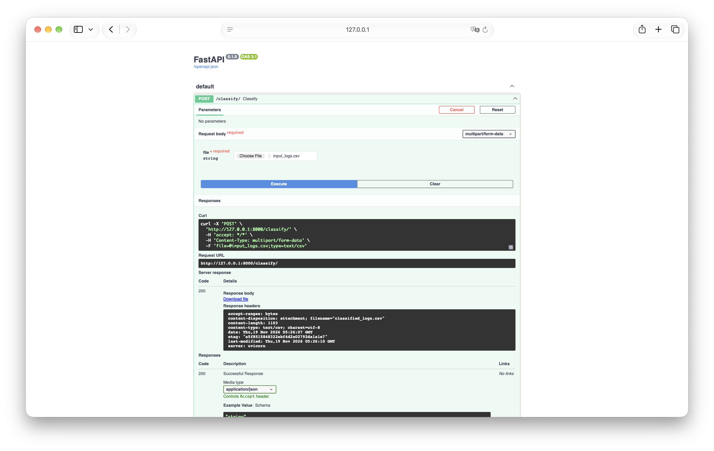
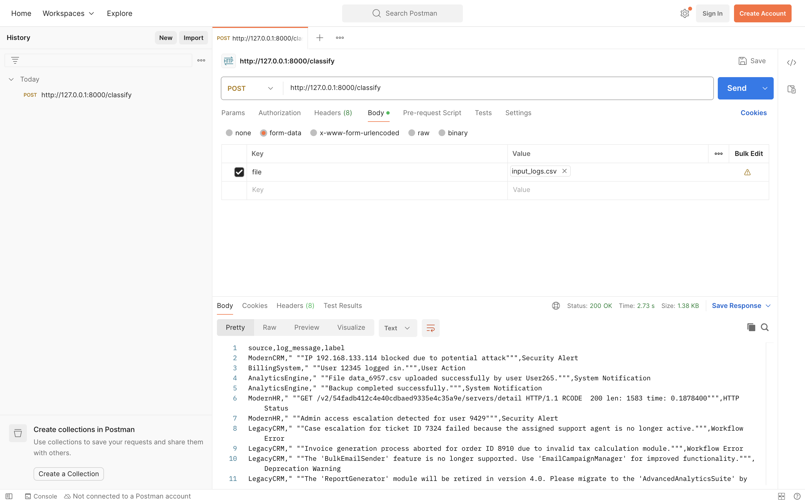

# Hybrid Log Classification System

A 3-tiered, cost-aware log classification pipeline and **FastAPI** service that combines **deterministic Regex rules**, **Sentence-BERT + Logistic Regression**, and a **Groq-hosted LLM** to categorize system logs with high accuracy and low inference latency.

---

## Architecture Overview

Rather than routing every log message through a heavy LLM, this system uses a **3-tier routing pipeline** informed by Exploratory Data Analysis (EDA) and unsupervised **DBSCAN clustering** on dense sentence embeddings:

```text
                        ┌─────────────────────────┐
                        │  Incoming Log Record    │
                        │ (source, log_message)   │
                        └────────────┬────────────┘
                                     │
                        ┌────────────▼────────────┐
                        │  Is source == LegacyCRM?│
                        └──────┬───────────┬──────┘
                          Yes  │           │  No
               ┌───────────────▼──┐     ┌──▼───────────────────────┐
               │   Tier 3: LLM    │     │   Tier 1: Regex Engine   │
               │   (Groq API)     │     │ (11 Deterministic Rules) │
               └───────┬──────────┘     └──┬───────────────────────┘
                       │                   │
                       │            Match? ├─── Yes ───► Return Label
                       │                   │
                       │                   ▼ No
                       │        ┌──────────────────────────┐
                       │        │   Tier 2: ML Classifier  │
                       │        │ MiniLM-L6-v2 Embeddings  │
                       │        │ + Balanced Logistic Reg. │
                       │        └──────────┬───────────────┘
                       │                   │
                       └─────────┬─────────┘
                                 ▼
                       ┌───────────────────┐
                       │  Final Log Label  │
                       └───────────────────┘
```

### Why Three Tiers?
1. **Tier 1 — Regex Engine (~69% of dataset):** Unsupervised DBSCAN clustering (`eps=0.4`, cosine distance) on `all-MiniLM-L6-v2` embeddings revealed rigid structural templates across `HTTP Status`, `Resource Usage`, `User Action`, `System Notification`, and specific `Error`/`Critical Error` logs. Matching these with compiled regular expressions resolves the majority of traffic in microseconds at zero API cost.
2. **Tier 2 — Dense Embeddings + Logistic Regression:** Unstructured or varied log messages fall through to a `LogisticRegression(class_weight='balanced')` classifier trained on 384-dimensional `all-MiniLM-L6-v2` embeddings. The model is trained on **all** non-legacy records (including regex-covered classes) as a defense-in-depth fallback in case formatting variations bypass regex rules.
3. **Tier 3 — LLM Fallback (`LegacyCRM`):** EDA revealed that `Workflow Error` (4 samples) and `Deprecation Warning` (3 samples) occur exclusively under `source == 'LegacyCRM'` and were isolated as `-1` outliers by DBSCAN. Because 7 samples are insufficient for supervised training, `LegacyCRM` logs are routed to Groq (`openai/gpt-oss-120b`) using structured `<category>` tag extraction.

---

## Model Performance

Evaluated on a stratified 30% holdout split (**687 logs** across 7 classes):

| Target Class | Precision | Recall | F1-Score | Support |
| :--- | :---: | :---: | :---: | :---: |
| **Critical Error** | 1.00 | 0.98 | 0.99 | 48 |
| **Error** | 1.00 | 1.00 | 1.00 | 53 |
| **HTTP Status** | 1.00 | 1.00 | 1.00 | 305 |
| **Resource Usage** | 1.00 | 1.00 | 1.00 | 50 |
| **Security Alert** | 0.99 | 1.00 | 1.00 | 111 |
| **System Notification** | 1.00 | 1.00 | 1.00 | 77 |
| **User Action** | 1.00 | 1.00 | 1.00 | 43 |
| **Overall Accuracy** | — | — | **1.00 (99.85%)** | **687** |

---

## Project Structure

```text
├── artifacts/
│   └── classifier.joblib                 # Trained Logistic Regression artifact
├── dataset/
│   └── classified_logs.csv               # Labeled training dataset
├── resources/                            # Temporary directory for API CSV outputs, also contains input csv for testing
├── clustering-and-model-training.ipynb   # EDA, DBSCAN clustering, training & error analysis
├── processor.py                          # Regex, MiniLM + LogisticRegression, and Groq LLM handlers
├── classify.py                           # Hybrid routing logic for single records and collections
├── server.py                             # FastAPI application exposing the /classify/ endpoint
├── requirements.txt                      # Python dependencies
└── .env                                  # Environment variables (GROQ_API_KEY)
```

---

## Setup & Installation

### 1. Clone the Repository & Create a Virtual Environment
```bash
git clone <your-repo-url>
cd <your-repo-name>
python -m venv venv
source venv/bin/activate  # On Windows: venv\Scripts\activate
```

### 2. Install Dependencies
```bash
pip install -r requirements.txt
```

### 3. Configure Environment Variables
Create a `.env` file in the project root and add your Groq API key:
```env
GROQ_API_KEY=your_groq_api_key_here
```

---

## Usage

### Run the FastAPI Server
```bash
uvicorn server:app --reload
```
Once running, open the interactive Swagger UI at **`http://127.0.0`**.

### Classify a CSV File via API
Send a `POST` request to `/classify/` with a `.csv` file containing `source` and `log_message` columns:

```bash
curl -X POST "http://127.0.0" \
  -H "accept: text/csv" \
  -H "Content-Type: multipart/form-data" \
  -F "file=@sample_logs.csv" \
  --output classified_logs.csv
```
The API appends a `label` column, streams back `classified_logs.csv`, and automatically removes temporary server files via FastAPI `BackgroundTasks`.

### Run Local CLI Classification Test
```bash
python classify.py
```

---

## API Demo

### 1. FastAPI Interactive Docs (Swagger UI)


### 2. Postman API Test


---

## Future Improvements
* **Confidence-Based LLM Escalation:** Route Tier 2 ML predictions with `max(predict_proba) < 0.50` to the LLM fallback layer.
* **Batch Embedding Inference:** Vectorize `embedding_model.encode()` across all non-regex logs in a single forward pass rather than encoding row-by-row.
* **In-Memory CSV Streaming:** Stream classified CSV responses directly via `io.StringIO` to eliminate temporary disk writes.
